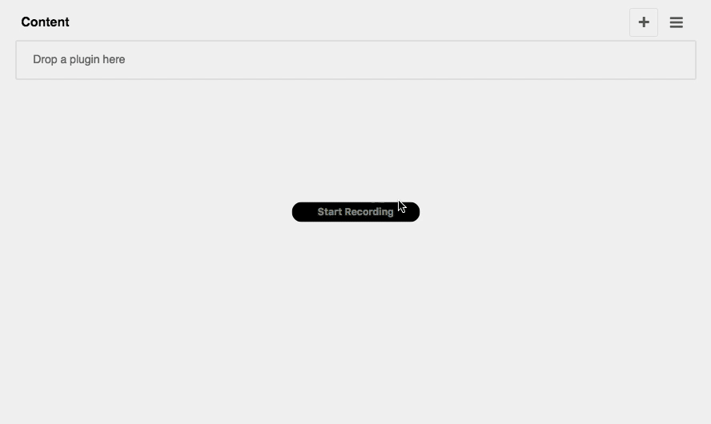

================
django CMS Video
================

|pypi| |build| |coverage|

**django CMS Video** is a set of plugins for `django CMS <http://django-cms.org>`_
that allow you to publish video content on your site (using an HTML5 player by default,
but you can override this in your own templates if required).

It uses files managed by `Django Filer <https://github.com/divio/django-filer>`_.

.. note:: 
        
        This project is endorsed by the `django CMS Association <https://www.django-cms.org/en/about-us/>`_.
        That means that it is officially accepted by the dCA as being in line with our roadmap vision and development/plugin policy. 
        Join us on `Slack <https://www.django-cms.org/slack/>`_.

*******************************************
Contribute to this project and win rewards
*******************************************

Because this is a an open-source project, we welcome everyone to
`get involved in the project <https://www.django-cms.org/en/contribute/>`_ and
`receive a reward <https://www.django-cms.org/en/bounty-program/>`_ for their contribution. 
Become part of a fantastic community and help us make django CMS the best CMS in the world.   

We'll be delighted to receive your
feedback in the form of issues and pull requests. Before submitting your
pull request, please review our `contribution guidelines
<http://docs.django-cms.org/en/latest/contributing/index.html>`_.

We're grateful to all contributors who have helped create and maintain this package.
Contributors are listed at the `contributors <https://github.com/django-cms/djangocms-video/graphs/contributors>`_
section.

Documentation
=============

See ``REQUIREMENTS`` in the `setup.py <https://github.com/divio/djangocms-video/blob/master/setup.py>`_
file for additional dependencies:

|python| |django| |djangocms|

These badges show the supported versions declared by the latest release on PyPI.

* Django Filer 1.7 or higher

Make sure `django-filer <http://django-filer.readthedocs.io/en/latest/installation.html>`_
is installed and configured appropriately.

Installation
------------

For a manual install:

* run ``pip install djangocms-video``
* add ``djangocms_video`` to ``INSTALLED_APPS`` in your project's settings file
  (usually ``<project_name>/settings.py``)
* run ``python manage.py migrate djangocms_video``

Configuration
-------------

Add all ``DJANGOCMS_VIDEO_*`` settings below to your project's settings file,
usually ``<project_name>/settings.py`` (the module selected by
``DJANGO_SETTINGS_MODULE`` in ``manage.py``).

Note that the provided templates are very minimal by design. You are encouraged
to adapt and override them to your project's requirements.

Custom templates
~~~~~~~~~~~~~~~~

This addon provides a ``default`` template for all instances. You can provide
additional template choices by adding a ``DJANGOCMS_VIDEO_TEMPLATES``
setting to your project's settings file::

    from django.utils.translation import gettext_lazy as _

    DJANGOCMS_VIDEO_TEMPLATES = [
        ('feature', _('Featured Version')),
    ]

The first value, ``feature``, is the template directory name; the second is the
label shown in the plugin's **Template** field.

Copy the files from this package's ``djangocms_video/templates/djangocms_video/default/``
directory into your own app, using this layout (``your_app`` is an app in your
project)::

    your_app/
        templates/
            djangocms_video/
                feature/
                    video_player.html
                    source.html
                    track.html

Ensure ``your_app`` is in ``INSTALLED_APPS`` and ``APP_DIRS`` is ``True`` in your
existing ``DjangoTemplates`` entry in ``TEMPLATES``. If you configure template
loaders explicitly instead, include
``django.template.loaders.app_directories.Loader``.

Alternatively, put the same ``djangocms_video/feature/`` directory under a
project-level ``templates/`` directory, alongside ``manage.py``. Add that directory
to ``DIRS`` in your existing ``DjangoTemplates`` entry in the project's settings
file, keeping any other directories already configured::

    "DIRS": [BASE_DIR / "templates"],

This example assumes ``BASE_DIR`` is a ``pathlib.Path`` pointing to the directory
containing ``manage.py``. Keep the other template settings, including context
processors. See Django's `template loading documentation
<https://docs.djangoproject.com/en/stable/ref/templates/api/#loader-types>`_
for details.

Edit the copied files, then select **Featured Version** in the **Video player**
plugin's **Template** field. The player loads
``djangocms_video/feature/video_player.html``; its **Source** and **Track** child
plugins load ``source.html`` and ``track.html`` from the same directory. Copy all
three files so that child plugins can render without a ``TemplateDoesNotExist``
error.

To customize the existing **Default** choice instead, use
``djangocms_video/default/`` in your own templates directory; no
``DJANGOCMS_VIDEO_TEMPLATES`` setting is needed. When using app templates for this
override, place ``your_app`` before ``djangocms_video`` in ``INSTALLED_APPS`` so
Django finds your templates first.

Make changes in your own project or app. Editing the installed package's files
would lose your changes when the package is updated or reinstalled.

Video settings
~~~~~~~~~~~~~~

``MP4``, ``WEBM`` and ``OGV`` files are allowed by default. We recommend
adding all 3 source files for full browser compatibility. You can change
the default setting by overriding::

    DJANGOCMS_VIDEO_ALLOWED_EXTENSIONS = ['mp4', 'webm', 'ogv']

The plugin detects YouTube URLs using a regular expression and canonicalizes
them to `//www.youtube.com/embed/{}` where the placeholder is replaced by the
video id.

The canonical URL can be reconfigured with a configuration setting::

    DJANGOCMS_VIDEO_YOUTUBE_EMBED_URL = '//www.youtube-nocookie.com/embed/{}'

Running Tests
-------------

You can run tests by executing::

    virtualenv env
    source env/bin/activate
    pip install -r tests/requirements.txt
    python setup.py test

.. |pypi| image:: https://badge.fury.io/py/djangocms-video.svg
    :target: http://badge.fury.io/py/djangocms-video
.. |build| image:: https://travis-ci.org/divio/djangocms-video.svg?branch=master
    :target: https://travis-ci.org/divio/djangocms-video
.. |coverage| image:: https://codecov.io/gh/divio/djangocms-video/branch/master/graph/badge.svg
    :target: https://codecov.io/gh/divio/djangocms-video

.. |python| image:: https://img.shields.io/pypi/pyversions/djangocms-video
    :target: https://pypi.org/project/djangocms-video/
    :alt: Supported Python versions
.. |django| image:: https://img.shields.io/pypi/frameworkversions/django/djangocms-video
    :target: https://pypi.org/project/djangocms-video/
    :alt: Supported Django versions
.. |djangocms| image:: https://img.shields.io/pypi/frameworkversions/django-cms/djangocms-video
    :target: https://pypi.org/project/djangocms-video/
    :alt: Supported django CMS versions
